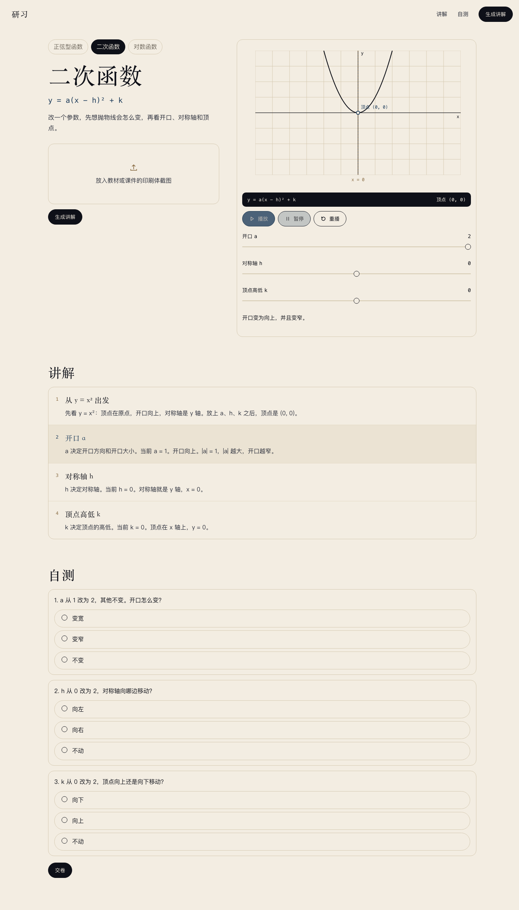
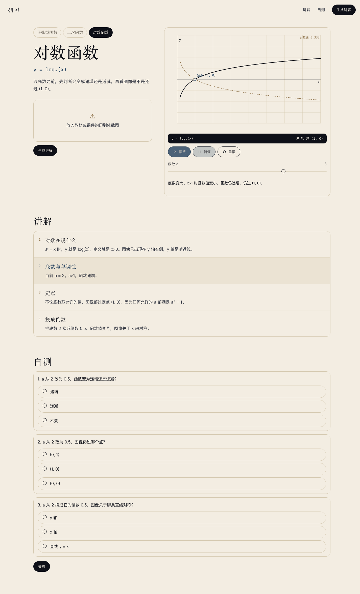

# 研习 · 正弦型函数 Lab 功能代码审计报告（v2）

| 项目 | 内容 |
| --- | --- |
| 审计版本 | v2，2026-11-08 09:25 左右 |
| 审计对象 | studylab：server/、web/、设计开发方案.md |
| 对照方案 | [设计开发方案.md](设计开发方案.md)（文件时间 2026-11-08 07:45，未随本次代码更新） |
| 代码基线 | Git 仓库仍无提交；server/ 与 web/ 均按当前工作树快照审计，无历史 diff |
| 审计方式 | 静态审阅 + 43 个后端测试 + 隔离实例 API 黑盒 + 真实本机视觉服务联调 + Chrome CDP 桌面/390px 端到端 + 三种概念族的参数穷举 |
| 总体结论 | 功能实现比 v1 明显前进：读图已真实可用，新增二次函数与对数函数，43 个测试通过；但方案没有同步更新，形成范围/API/验收基线漂移。运行层面仍有 1 个高优先级一致性问题、若干中优先级问题，以及 v1 遗留的边界问题。 |

## 0. 结论摘要

这一版最重要的变化不是修 bug，而是产品范围变了：

1. 读图从“永远 unknown 的适配器”变成真实的本机视觉服务调用。实测 qwen36 能正确读出 y = 2sin(3x+π/2) 的 A=2、ω=3、φ=1.570796，二次函数一般式 y=x²−2x+1 的 a=1、b=−2、c=1，以及 y=log₃(x) 的底数 3；中文教材式图片也能读对。
2. 新增二次函数与对数函数两个概念族，页面增加知识点切换；接口增加 concept 参数、concept 查询参数和 confirm=quadratic/logarithm。
3. 后端测试从 16 个增加到 43 个，新增 test_quadratic.py、test_logarithm.py、test_vision.py；43 个测试全部通过。
4. 方案 [设计开发方案.md](设计开发方案.md) 仍是“只做正弦型函数、读图还不能工作”的版本，明确把二次函数列为不做，把第二个概念族列在下一版。代码与方案现在是两套事实。

因此本次审计的结论要分两层：

- 按代码功能：主链路更完整，读图真实可用，三种概念族的数学生成与判分都通过实测和穷举。
- 按开发方案：不能判定为符合。方案未更新，新增能力没有对应的验收口径、API 契约、测试要求与运行说明；如果方案仍是权威基线，二次函数/对数函数属于范围外功能。

运行层面最需要先修的仍是同一个问题：拖动滑杆后，动画、读数、caption 更新了，四步讲解正文仍写生成时的旧参数。v1 在正弦型函数上发现；v2 在二次函数和对数函数上同样成立，而且因为新增了概念切换，影响面更大。

其次是自检：v2 仍然只校验方向词、固定文本和检查题重算，不校验讲解正文里的参数数值；正弦型函数的周期校验仍可被前缀字符串绕过。把“当前 a = 1”改成“当前 a = 99”、把顶点改成 (9, 9)，自检仍返回通过。当前模板输出是正确的，但自检不能兑现“数学正确”的守门承诺。

## 1. 与 v1 相比发生了什么

| 维度 | v1 | v2 |
| --- | --- | --- |
| 概念族 | 只有 sinusoid | sinusoid + quadratic + logarithm |
| 读图 | [server/vision.py](server/vision.py) 固定返回 unknown | 调用本机 127.0.0.1:8010 的视觉模型；带 PIL 预处理、JSON 解析、数值归一化 |
| API | /api/sample 无 concept；confirm 仅 sinusoid / reject | /api/sample?concept=...；表单新增 concept；confirm 支持三个概念 |
| 前端 | 单页正弦型函数 | 三个知识点标签、三个 Canvas stage、三类滑杆与读数 |
| 自检 | sinusoid 有周期/方向检查 | 新增 quadratic/logarithm 自检；但都不校验正文数值 |
| 测试 | 16 个 | 43 个，新增 3 个测试文件 |
| 方案 | 与 v1 一致 | 未更新；§3/§6/§7/§8/§10/§11/§12/§14/§15 都已与代码不一致 |

v1 报告在 [功能代码审计报告.md](功能代码审计报告.md)；本报告不覆盖 v1，作为 v2 的独立快照。

## 2. 实际能力验证

### 2.1 后端测试

    $ server/.venv/bin/pytest server -q
    43 passed, 1 warning in 0.24s

新增测试覆盖二次函数默认/开口/对称轴/顶点/夹取/判分/422/拒绝、对数函数默认/底数小于 1/夹取/判分/422/拒绝，以及视觉解析、模型失败降级、跨概念追问、识别参数生成和确认读取参数。

### 2.2 真实视觉联调

本机视觉服务 127.0.0.1:8010 可用，模型为 qwen36，用 PIL 生成印刷体公式图后直接调用 vision.recognize，结果如下：

| 输入 | concept | 读取结果 |
| --- | --- | --- |
| y = 2 sin(3x + pi/2) | sinusoid | A=2，omega=3，phi=1.570796，evidence 正确 |
| y = x^2 - 2x + 1 | quadratic | a=1，b=-2，c=1；生成课程后 h=1，k=0 |
| y = log_3(x) | logarithm | base=3 |
| 例 已知函数 y = 2sin(3x + π/2) | sinusoid | A=2，omega=3，phi=1.570796 |
| y = A sin(w x + phi) | sinusoid | 参数全 null，生成时使用默认值并写“未标出参数” |
| 同一张图里两条不同公式 | unknown | 不生成，返回追问 |
| Hello world / 三角形 | unknown | 不生成，返回追问 |

结论：读图不是“假装识别”。印刷体、中文教材式、二/三次式、对数式都能读对；多题图与无关图会拒绝。

### 2.3 通过真实图片的 API 端到端

| 请求 | 结果 |
| --- | --- |
| POST /api/lessons，concept=sinusoid，上传 y=2sin(3x+pi/2) | 返回 sinusoid 课程，params [A=2, omega=3, phi=1.570796]，note=null |
| POST /api/lessons，concept=quadratic，上传 y=x²-2x+1 | 返回 quadratic 课程，params [a=1, h=1, k=0] |
| POST /api/lessons，concept=logarithm，上传 y=log₃(x) | 返回 logarithm 课程，params [base=3] |
| sinusoid 图片放在 quadratic 标签下 | 不生成，返回二次函数追问 |
| confirm=sinusoid + sinusoid 图片 | 生成课程，参数来自图片，不是默认值 |
| 上述三节课程提交正确选项 | 均为 3 / 3 |
| 上述三节课程提交错误选项 | 均为 0 / 3 |

### 2.4 参数空间与自检穷举

| 概念族 | 取值范围 | 组合数 | 自检失败 |
| --- | --- | --- | --- |
| sinusoid | A 0.5–2.5 步 0.1；omega 0.5–3 步 0.1；phi -3.14–3.14 步 0.01 | 343,434 | 0 |
| quadratic | a -2–2 步 0.1（跳过 0）；h/k -3–3 步 0.5 | 5,408 | 0 |
| logarithm | base 0.25–4 步 0.05（跳过 0.8 到 1.25 之间） | 68 | 0 |

这只能说明当前生成器在滑杆可达范围内自洽，不能证明自检能识别篡改；见 V2-03。

### 2.5 浏览器端到端（Chrome 156，CDP）

| 场景 | 结果 |
| --- | --- |
| 1440px 默认加载 | 正弦型函数正常播放；三个知识点标签都在 |
| 点二次函数标签 | 标题、公式、读数、三道题切换为二次函数；顶点 (0, 0) |
| 点对数函数标签 | 标题、公式、读数切换；递增，过 (1, 0) |
| 二次函数 a 从 1 拖到 2 | 读数仍为顶点 (0, 0)；caption 变为“开口变为向上，并且变窄。”；讲解 b2 仍写“当前 a = 1” |
| 对数函数 base 从 2 拖到 3 | 读数仍为“递增，过 (1, 0)”；caption 说“底数变大…”；讲解 b2 仍写“当前 a = 2” |
| 上传 sinusoid 图片并生成 | 页面显示 A=2、ω=3、T=2π/3，b1/b2/b3 与参数一致 |
| 上传 quadratic 图片并生成 | 页面显示 a=1、h=1、k=0，b1/b2/b3 与参数一致 |
| 390px 视口 | innerWidth=390，scrollWidth=390；三个标签一行放下，无横向溢出 |

## 3. 方案逐条对照

### 3.1 明确冲突项

| 方案条款 | 方案原话/要求 | v2 代码 | 结论 |
| --- | --- | --- | --- |
| §3 范围 | “不做……其他概念族（指数、二次函数、立体几何）” | 新增 quadratic、logarithm 两个概念族与页面切换 | 冲突；若方案有效则是范围外功能 |
| §6 读图现状 | “第一版不能把上传就认对了写成已接通”“有图：不把图判成正弦型函数，返回追问” | 视觉服务真实读取参数并直接生成课程 | 冲突；方案描述已过时 |
| §7 接口 | /api/sample 无概念参数；confirm 只有 sinusoid / reject；响应只有正弦型函数 | 新增 concept 查询参数、concept 表单字段、confirm=quadratic/logarithm，返回三种 animation.type | 方案未定义，属契约扩展 |
| §8 界面 | 页面结构只有正弦型函数 | 新增知识点 tablist、三个 stage、三类读数 | 方案未定义 |
| §10 代码结构 | server 只有 app/skill/sinusoid/vision/test_sinusoid；web 只有 index/styles/app/sinusoid | 新增 quadratic.py、logarithm.py、test_quadratic.py、test_logarithm.py、test_vision.py、quadratic.js、logarithm.js | 方案未更新 |
| §11 测试 | 只列正弦型函数的 7 个场景 | 43 个测试，覆盖三种概念族与视觉解析 | 方案未更新 |
| §12 验收 | 只验收正弦型函数 | 新增能力没有对应验收条款 | 无法按方案验收 |
| §14 下一版 | 第二概念族、真实视觉接口都列在下一版 | v2 已实现 | 方案未更新 |
| §15 风险 | 读图目前是断的 | 读图已接通；风险转为配置、隐私、误读、时延 | 方案未更新 |

### 3.2 仍然符合或部分符合的方案项

| 方案条款 | 当前实现 | 结论 |
| --- | --- | --- |
| §4 默认样例、上传追问、确认、拒绝 | 三种概念族都走同一套四路径；有图先读图，不匹配则追问 | 符合 |
| §5 正弦型函数数学口径 | 周期、方向、振幅、夹取、检查题重算与 v1 一致；343,434 组穷举通过 | 符合 |
| §6 四步管线 | 读图、列讲解、生成、自检仍在；模型只提供概念与数字 | 结构符合 |
| §6 自检 | 参数范围、方向、检查题唯一答案、beats 完整性有检查；周期可绕过、正文数值不校验 | 部分符合 |
| §6 两次自检失败 422 | 三种概念族都有 assemble 包装，测试覆盖 | 符合 |
| §7 成功/追问/拒绝/错误码 | 字段、状态码与文案基本保持；新增概念字段未入方案 | 部分符合 |
| §7 判分按服务端课程 | LESSONS 中的 checks 判分；三种概念族 3/3 与 0/3 实测 | 符合 |
| §8 视觉 token、纸色、字体、胶囊、窄屏 | v1 视觉体系保留；新增标签样式一致；390px 无溢出 | 符合 |
| §9 正弦动画、播放、滑杆、焦点 | 有效；但 t=0 左侧半段已显示为已走过，F-06 未修 | 部分符合 |
| §13 运行 | uvicorn、pytest 命令可用；视觉服务与密钥配置未写入方案 | 部分符合 |
| §1 三条过关标准 | 数学核心正确；但滑杆改参后讲解正文与实际参数矛盾 | 部分符合 |

## 4. 问题清单

| ID | 严重度 | 问题 | 证据/位置 |
| --- | --- | --- | --- |
| V2-01 | 高（方案一致性） | 方案未更新，代码新增两概念族并把读图接通，范围/API/验收全面漂移 | 设计开发方案.md；server/quadratic.py；server/logarithm.py；server/vision.py |
| V2-02 | 高 | 滑杆改参后三种概念的讲解正文都不更新，与读数/caption 矛盾 | web/app.js 滑杆与讲解渲染；server 三套 beat 模板 |
| V2-03 | 中 | 自检不校验讲解正文的参数数值；正弦周期仍可被前缀绕过 | 三种 inspect_lesson；实测篡改全部通过 |
| V2-04 | 中 | 读图失败与“看不出知识点”不可区分，用户只看到追问 | app.py 无 readFailed 分支；8789 vision off 实测 |
| V2-05 | 中 | 视觉密钥来源过宽（含本机 LaunchAgent plist），base URL 可配远端，图片/密钥可外发 | vision.py _api_key、_base_url、complete |
| V2-06 | 中 | 视觉的 evidence/confident 未呈现；误读不可见；读失败仍标 confident=true | vision.parse_model_text；三个 build_lesson；skill 的 CONFIRMED_NOTE |
| V2-07 | 中 | 上传类型/空文件不校验真实内容；8MB 在整体读入后才判；LESSONS 无上限 | app.py 43–58、152–166；LESSONS 40 |
| V2-08 | 低 | 对数底数滑杆把 1 与非法区间放进 min/max；二次函数 a=0 会跳到 -0.5 | web/app.js snapBase、snapA；实测 |
| V2-09 | 低 | 视觉 120 秒超时、无前端超时、冷启动/切换成本、无速率限制 | vision.py 21–22；web/app.js postLesson |
| V2-10 | 低 | 图片解码只限压缩后 8MB，不限像素；存在解压炸弹/内存峰值风险 | vision.py _prepare |
| V2-11 | 低 | 初始 sample 与概念切换的请求竞态；离线时新概念自测为空；tab/aria 缺口 | web/app.js loadSample、builtinQuadratic/Logarithm；index.html |
| V2-12 | 低 | 三套概念各复制一份自检/模板/前端 stage；测试未覆盖真实视觉、前端与边界 | 代码结构与 43 个测试 |

### V2-01（高，方案一致性）方案没跟上代码，新增能力没有验收基线

**证据**

- [设计开发方案.md](设计开发方案.md) 的 §3 明确把二次函数列在“不做”里：[设计开发方案.md](设计开发方案.md#L49-L58)。
- §6 明确写当前读图是断的、第一版不能把“上传就认对了”写成已接通：[设计开发方案.md](设计开发方案.md#L138-L152)。
- §7 的接口只有 sinusoid，confirm 只允许 sinusoid/reject；没有 concept 字段：[设计开发方案.md](设计开发方案.md#L154-L169)。
- §10 的代码清单没有 quadratic.py、logarithm.py、test_quadratic.py、test_logarithm.py、test_vision.py、quadratic.js、logarithm.js：[设计开发方案.md](设计开发方案.md#L329-L346)。
- §11 只列正弦型函数的测试；§12 只验收正弦型函数；§14 把第二个概念族和真实视觉接口放到下一版；§15 说读图目前是断的。
- 代码侧已经实际存在这些文件与路径：新增 [server/quadratic.py](server/quadratic.py)、[server/logarithm.py](server/logarithm.py)、[server/test_quadratic.py](server/test_quadratic.py)、[server/test_logarithm.py](server/test_logarithm.py)、[server/test_vision.py](server/test_vision.py)，以及 [web/quadratic.js](web/quadratic.js)、[web/logarithm.js](web/logarithm.js)。
- 方案文件时间仍是 07:45，代码更新时间在 08:45–08:56，说明不是文档渲染滞后，而是文档没有更新。

**影响**

- 现在无法用一句话回答“是否符合开发方案”：按 §3 是超范围，按 §6 是相反事实，按 §7 是未定义契约，按 §12 是缺少验收。
- 新增概念族没有对应的产品定义：二次函数/对数函数的参数范围、讲解口径、检查题答案、窄屏验收、错误文案都没有在方案里评审过。
- 视觉现在真实可用，但方案仍把读图风险描述成“断的”；上线/汇报/交接会基于错误事实。
- 如果二次函数/对数函数是误合入或实验功能，当前没有 feature flag、没有按概念关闭的开关，用户会直接看到。

**建议**

1. 先决定方向：把方案更新为 v2（三概念族、真实视觉、concept API、配置与隐私、验收与测试），或者把 quadratic/logarithm 放回实验分支/功能开关。不要同时保留“方案只做正弦”和“页面已有三个概念”。
2. 更新方案时至少补：§3 范围、§6 读图现状与失败策略、§7 concept/confirm 契约、§8 知识点切换、§9 三种动画、§10 文件结构、§11 测试、§12 验收、§13 视觉服务启动与密钥配置、§15 新风险。
3. 为三种概念分别写可执行验收：默认样例、参数改变后的文案、三道题答案、窄屏、错误码。

### V2-02（高）滑杆改参后三种概念的讲解正文都不更新

**复现**

二次函数：点二次函数标签，把 a 从 1 拖到 2。

    readout-period : 顶点 (0, 0)
    caption        : 开口变为向上，并且变窄。
    b2             : a 决定开口方向和开口大小。当前 a = 1。开口向上。|a| = 1，|a| 越大，开口越窄。
    自测第 1 题     : a 从 1 改为 2，其他不变。开口怎么变？

对数函数：点对数函数标签，把 base 从 2 拖到 3。

    readout-period : 递增，过 (1, 0)
    caption        : 底数变大。x>1 时函数值变小，函数仍递增，仍过 (1, 0)。
    b2             : 底数与单调性 当前 a = 2。a>1，函数递增。
    b4             : 把底数 2 换成倒数 0.5。函数值变号，图像关于 x 轴对称。

正弦型函数在 v1 已复现：A/ω/φ 改为 2/2/1.57 后，读数 T=π，b2/b3 仍写 T=2π。v2 代码没有修改这条路径。

**位置**

- 三套后端 beat 模板都把生成时的参数写进正文：[server/sinusoid.py](server/sinusoid.py#L212-L247)、[server/quadratic.py](server/quadratic.py#L227-L263)、[server/logarithm.py](server/logarithm.py#L108-L146)。
- 前端滑杆只做 value/readout/stage.setParams，不更新讲解 DOM：[web/app.js](web/app.js#L407-L420)；讲解只渲染一次：[web/app.js](web/app.js#L319-L339)。
- 三种 stage 的 setParams 只重画与发 caption：[web/quadratic.js](web/quadratic.js#L314-L332)、[web/logarithm.js](web/logarithm.js#L282-L292)、[web/sinusoid.js](web/sinusoid.js#L512-L530)。

**影响**

- 高。三种概念都有“当前参数”正文；改参后正文变成错误陈述。
- 检查题也仍按生成时的参数出题；例如二次函数 a 已到 2，第 1 题仍问 a 从 1 改为 2。
- 这直接违背方案 §9 “改完立刻重画并写当前焦点那句因果”和 §12 “文案说图像变密”的验收精神；v1 的结论在 v2 上扩大为三倍。

**建议**

1. 选择“基准参数”与“当前参数”分离，或把正文改成不含具体数值的因果句，把 A/a/base/T/h/k 只放在读数与 caption。
2. 若保留“当前”正文，就在 setParams 时用同一套模板重写 b1–b4，并决定检查题是否重算；若重算，生成新 lesson id，服务端按新课程判分。
3. 加前端一致性测试：任意滑杆值下，页面所有 T/参数文本与滑杆值一致，检查题与当前参数关系有明确标注。

### V2-03（中）自检不校验讲解正文的数值，周期仍可被前缀绕过

**复现（脚本，2026-11-08）**

对三种概念的有效课程做最小篡改，再调用 inspect_lesson：

    sinusoid 当前 A = 1 -> 当前 A = 99          => (True, '')
    sinusoid 当前 omega = 1 -> 当前 omega = 99  => (True, '')
    sinusoid T = 2π -> T = 2π/3                => (True, '')
    quadratic 顶点 (0, 0) -> (9, 9)             => (True, '')
    quadratic 当前 a = 1 -> 当前 a = 99         => (True, '')
    quadratic x = 0 -> x = 99                  => (True, '')
    quadratic y = 0 -> y = 99                  => (True, '')
    logarithm 当前 a = 2 -> 当前 a = 99         => (True, '')
    logarithm x>0 -> x>99                      => (True, '')
    logarithm 0.5 -> 9                         => (True, '')

**根因**

- 正弦型函数自检用 f"T = {period_text}" 做子串包含：[server/sinusoid.py](server/sinusoid.py#L362-L364)。“T = 2π” 是 “T = 2π/3” 的前缀，错误文本通过。
- 自检解析的是 format_period 的输出，不是讲解正文：[server/sinusoid.py](server/sinusoid.py#L355-L361)。
- 二次函数只检查方向词与固定句，不检查 b1 顶点坐标、b2 当前 a、b3 当前 h、b4 当前 k：[server/quadratic.py](server/quadratic.py#L355-L379)。
- 对数函数只检查单调性词、定点、x 轴对称，不检查 b2 当前 base、b1 定义域数值、b4 倒数数值：[server/logarithm.py](server/logarithm.py#L213-L235)。

**规格对照**

§6 自检条目明确要求“讲解文本里的周期与 2π/|ω| 一致，容差 10^-6”。当前周期校验没有真正读取讲解里的数值。三种概念的正文数值也没有任何校验。

**影响**

- 中。当前三套模板输出正确，所以默认课程不会立刻出错；但自检是返回前端前的数学门禁，门禁对“正文数值”失效。
- 换模板、改文案、加概念族、让模型参与正文时，错误数值可能直接上线。
- 对“数学正确”这条产品验收标准，这是防御性缺陷，而不是当前可见错误。

**建议**

1. 用正则从正文提取所有 T/参数数值，与当前参数比较；或让正文由结构化 token 生成，自检比对 token。
2. 对二次函数 b1 顶点、b2 a、b3 h、b4 k 分别断言数值；对对数函数 b2 base、b4 倒数、b1 定义域断言。
3. 增加篡改回归测试，要求上述每一种篡改都返回 False。
4. 对检查题增加独立数学验算，不只比较 build_checks 自己的输出。

### V2-04（中）读图失败与“看不出知识点”不可区分

**复现**

用 STUDYLAB_VISION=0 启动隔离实例 8789，上传一张合法的正弦型函数图片：

    POST /api/lessons, concept=sinusoid, image=...
    => 200，id=null，asked="这张图是在讲正弦型函数 y = A sin(ωx + φ) 吗？"

再 confirm=sinusoid + 同一张图：

    => 生成默认 A=1、ω=1、φ=0，note="这版还不能从图片读出参数。图上未标出参数…"

也就是说：视觉服务关闭、密钥错误、超时、模型输出不可解析时，用户看到的都是同一句“这张图是在讲…吗？”，而不是“读图服务不可用”。

**位置**

- [server/app.py](server/app.py#L177-L181) 的非确认分支没有检查 recognition.readFailed，直接走 recognition_matches；不匹配就 _ask_body。
- 只有确认分支在 [server/app.py](server/app.py#L173-L175) 检查了 readFailed，并退回默认课程。
- [server/vision.py](server/vision.py#L302-L317) 把所有异常统一变成 readFailed=true，没有错误原因字段。

**影响**

- 中。学生/老师会以为图里不是正弦型函数，而不是读图服务坏了；可能继续换图、确认默认参数，得到一节与图无关的课。
- 视觉是本版新增核心能力，失败路径却无法诊断；运维也没有健康检查。

**建议**

- 在追问响应里带 recognition.reason/error，例如“读图服务不可用”“模型没有返回有效 JSON”“图片无法解码”，前端显示可操作提示。
- 对 readFailed 直接返回 200 的明确提示，或返回可重试错误；不要伪装成知识点不匹配。
- 增加 /api/health 的 vision 子检查或 /api/vision/health。
- 为 vision 关闭、401、超时、坏图分别加测试。

### V2-05（中）视觉密钥来源过宽，图片/密钥可被配置发往远端

**位置**

- [server/vision.py](server/vision.py#L102-L113) 的 _api_key 依次读 STUDYLAB_VISION_API_KEY、QWEN38_API_KEY、SPLASH_API_KEY；都没有时读取 ~/Library/LaunchAgents/com.local.splash.plist 的 ProgramArguments。
- [server/vision.py](server/vision.py#L116-L117) 的 _base_url 读 STUDYLAB_VISION_BASE，默认 http://127.0.0.1:8010。
- [server/vision.py](server/vision.py#L265-L299) 的 complete 把图片转 base64，连同 Authorization 发给 base URL。

**正面**

- 密钥没有写进仓库、没有进前端、没有打印日志；默认 base 是 loopback；读图在服务端线程中执行。
- 实际联调只需要本机服务；当前默认路径不暴露密钥。

**风险**

- 读取另一个应用（splash）的 LaunchAgent plist 获取密钥，超出本应用配置边界；换机器/换用户/换服务时会静默失败或误用无关密钥。
- STUDYLAB_VISION_BASE 一旦被设成远端地址，图片和 Authorization 都会发往该地址；代码没有 loopback 校验、allowlist、TLS 要求或用户告知。
- 若按 §13 只监听 127.0.0.1，远程攻击面小；但若监听 0.0.0.0，任何能访问端口的人都能调用视觉服务并消耗模型。
- 方案 §6 原本要求“密钥只从环境变量读”，v2 增加了 plist 路径，方案没更新。

**建议**

1. 只保留一个明确的应用专用配置源（例如 STUDYLAB_VISION_API_KEY + STUDYLAB_VISION_BASE），删除 plist 抓取和无关的 SPLASH/QWEN 变量。
2. 默认只允许 loopback base；远端必须显式 opt-in，并在页面/README 说明图片会离开本机、密钥会发送到该地址。
3. 配置缺失/401/超时时给出明确提示，不要静默变成“看不出”。
4. 运行时把视觉调用限制在受控并发与速率；本地单用户也应有上限。

### V2-06（中）视觉 evidence/confident 没有呈现，误读不可见

**位置与事实**

- vision.parse_model_text 会返回 evidence 与 readFailed：[server/vision.py](server/vision.py#L189-L229)。
- 但 app/skill 生成课程时没有把 evidence 放进 lesson；三种 build_lesson 的 recognition 固定为 confident=true：[server/sinusoid.py](server/sinusoid.py#L260-L262)、[server/quadratic.py](server/quadratic.py#L273-L275)、[server/logarithm.py](server/logarithm.py#L156-L158)。
- 读图失败后 confirm 仍走 build_lesson，于是 response 里 recognition.confident=true，同时 parameterNote 写“这版还不能从图片读出参数”。
- 真实图片生成的课程 parameterNote 为 null，页面上只有 b1–b4 的当前参数，没有“图上读到 A=2”或 evidence。

**复现**

    confirm=quadratic 无图：
    recognition = {confident: true, asked: null}
    parameterNote = 这版还不能从图片读出参数。图上未标出参数…

**影响**

- 中。模型读错一个数（例如把 2 读成 1）时，课程内部数学完全自洽，自检也通过；用户只能自己对照图片发现，页面没有任何“读到什么”的证据。
- confident=true 与“读不出参数”同时出现，API 语义自相矛盾。
- 读图失败/模型返回 unknown 时，note 的“图上未标出参数”可能是假的：图上有数字，只是没读出来。

**建议**

- 把 evidence、识别到的原始概念、readFailed、参数来源放进 lesson.recognition；页面显示“图上读到：y=2sin(3x+π/2)”。
- 读图失败/默认参数时把 confident 设为 false，并区分“图上未标出”和“没有读出”。
- 对识别参数增加一次人工确认或“参数不对？点这里改”，或者至少在参数滑杆旁标注“来自图片识别”。

### V2-07（中）v1 的上传/资源边界仍在

**复现（更新后 8788）**

| 请求 | 状态 | 结果 |
| --- | --- | --- |
| page.png + text/plain | 200 | 返回追问，未拒绝 |
| notes.txt + image/png | 200 | 返回追问，未拒绝 |
| 0 字节 page.png | 200 | 返回追问，未拒绝 |
| 9MB page.png | 400 | 拒绝，但发生在读完整个上传之后 |

**代码**

- 类型判断仍是 Content-Type 或扩展名二选一：[server/app.py](server/app.py#L43-L58)。
- 仍然先 request.form()、upload.read()，再校验大小：[server/app.py](server/app.py#L152-L166)。
- LESSONS 全局 dict 仍无上限/过期：[server/app.py](server/app.py#L40)。

**影响**

- F-03（名义校验）依旧：假图片会进入 vision._prepare，解码失败后返回 readFailed，再变成追问；不会崩溃，但错误文案与实际能力不符。
- F-04（先读后判）依旧：超大 multipart 会先写临时文件、再读进内存；9MB 的 400 只能证明结果，不证明读取受限。
- F-05（LESSONS 无上限）依旧；视觉生成每节都写入，长期运行内存持续增长。

**建议**

1. 解析前检查 Content-Length/ASGI 累计字节；解析后先看 upload.size，再决定是否 read。
2. 校验 magic bytes、拒绝 0 字节，必要时用 Pillow 限制像素。
3. LESSONS 加 LRU/TTL，并在生成失败/拒绝时确认不写入。

### V2-08（低）滑杆暴露非法值，并出现跳变

**复现**

对数函数 base 滑杆的 min/max 是 0.25–4，step 0.05，但合法集合是 [0.25, 0.8] 与 [1.25, 4]。把值设为 0.85、0.95、1.05、1.15：

    0.85 -> 1.25
    0.95 -> 0.8
    1.05 -> 1.25
    1.15 -> 0.8

二次函数 a 滑杆 min/max 是 -2–2，step 0.1，但 0 不合法。把 a 设为 0：

    2 -> -0.5
    读数不变，caption “开口变为向下，并且变宽。”

**影响**

- 低。服务端 resolve 会夹取，不会生成非法课程；但滑杆轨道与实际可接受集合不一致，拖动时会突然跨过 0 或 1，用户难以预测。
- 对数函数 base=1 在滑杆轨道上是可达位置，虽然 snapBase 会改成 0.8 或 1.25；这会让“底数”看起来有一段不可用区间，但没有解释。

**建议**

- 用两段式滑杆/两个输入框/带标记的 range 表示合法集合；或把 min/max 改成可接受的连续区间并在页面解释 1 附近不可用。
- 二次函数 a 的 0 缺口用明确文案“a=0 不是二次函数，已跳到 -0.5”或禁用该位置。

### V2-09（低）视觉时延与超时缺少产品级处理

**事实**

- [server/vision.py](server/vision.py#L21-L22)：MAX_EDGE=1280，TIMEOUT_SECONDS=120。
- 实测首次读图约 6.4 秒，后续约 1.8 秒；服务模型信息给出切换约 12–18 秒、冷启动约 8–70 秒。
- [web/app.js](web/app.js#L485-L525) 的 postLesson 没有 fetch 超时，只把按钮置为“正在生成”。
- [server/app.py](server/app.py#L173-L178) 用 asyncio.to_thread 调 vision；每个上传占用一个线程，无并发上限。

**影响**

- 低到中。视觉服务冷启动/卡住时，用户会长时间看到“正在生成”，无法取消或重试；服务端线程池可能被占满。
- 本机单用户影响有限，若监听 0.0.0.0 则更明显。

**建议**

- 前端加超时与取消；服务端把视觉超时缩短到产品可接受范围，并限制并发/排队；返回明确的重试提示。
- /api/health 暴露 vision 状态与模型名。

### V2-10（低）图片解码只限压缩大小，不限像素

**位置**

[server/vision.py](server/vision.py#L232-L245)：Image.open 后 convert(RGB)、thumbnail；上游只限制 8MB 压缩字节。

**影响**

- 低到中。一个高度压缩的大图可以在解码时占用大量内存；Pillow 有默认像素告警但有阈值，代码没有显式限制。
- 本机工具风险较低；若服务对局域网开放则是资源攻击面。

**建议**

- 读取前检查图片头尺寸；显式设置/检查 Image.MAX_IMAGE_PIXELS；拒绝超过合理像素数的图；捕获 DecompressionBombError。
- 对 EXIF 旋转做 transpose，避免手机照片方向错误。

### V2-11（低）请求竞态、离线新概念自测为空、无障碍缺口

**竞态**

- 页面加载即 loadSample(false)（[web/app.js](web/app.js#L705)），没有请求序号/AbortController；若用户先上传生成，初始 sample 的旧响应可能覆盖新课程。
- 概念 tab 的点击在 state.generating 时被拦截（[web/app.js](web/app.js#L686-L703)），但初始 loadSample(false) 不设置 generating；tab 可与之并发，旧响应还会通过 applyLesson 把 tab 切回去。

**离线**

- builtinQuadratic/builtinLogarithm 的 checks 是空数组（[web/app.js](web/app.js#L104-L154)）；服务断开时，二次/对数页面没有自测题，而 builtinLesson 有 3 道。
- 离线提交会显示“服务没连上”，但空白自测区没有解释。

**无障碍**

- 概念 tabs 有 role=tab、aria-selected，但没有 aria-controls、没有方向键导航（[web/index.html](web/index.html#L24-L28)）。
- file input 仍无 label/aria-label（[web/index.html](web/index.html#L35)）。
- check-banner 与 verdict/explain 没有 aria-live（[web/index.html](web/index.html#L93)、[web/app.js](web/app.js#L588-L599)）。
- 自动播放没有 prefers-reduced-motion 分支。

**建议**

- 请求编号/AbortController；初始加载完成前禁用生成与 tab。
- 离线新概念至少给出“自测需要服务”提示，或提供静态题。
- 补 aria-controls、键盘导航、aria-live、label、减少动效。

### V2-12（低）重复实现与测试缺口

- 三套后端自检、三套前端 stage、三份 builtin 课程，逻辑相似但各写一份；新增概念越多，维护成本越高。
- [server/quadratic.py](server/quadratic.py#L395-L397) 和 [server/logarithm.py](server/logarithm.py#L239-L241) 的 self_check 没有 try/except；若 inspect_lesson 遇到异常值，可能抛异常而不是返回 422（正弦型的 self_check 有 try/except）。
- 43 个测试覆盖了三种概念族的主要路径，但没有真实视觉集成、没有前端/E2E 测试、没有上传伪造/空文件/超大 body、没有 LESSONS 上限、没有自检数值篡改、没有滑块非法区间、没有读图失败 UX。
- test_quadratic_image_asks_and_confirm_notes_unread_params 仍以“confirm 无图也生成”为预期，等于把 V1 的 F-07 固化进测试；需要产品明确这是否是期望行为。

**建议**：把真实视觉联调做成可选集成测试；把本报告的穷举与篡改脚本纳入 CI；补前端 E2E 与边界测试；抽取三套概念共享的管线。

## 5. v1 问题状态对照

| v1 ID | v1 问题 | v2 状态 | 说明 |
| --- | --- | --- | --- |
| F-01 | 滑杆改参后正文不更新 | 未修复，扩大到三种概念 | V2-02 |
| F-02 | 自检周期可被前缀绕过 | 未修复，并扩大到数值校验 | V2-03 |
| F-03 | 类型/空文件校验形同虚设 | 未修复 | V2-07 |
| F-04 | 8MB 在整体读入后才判 | 未修复 | V2-07 |
| F-05 | LESSONS 无上限 | 未修复 | V2-07 |
| F-06 | t=0 波形左半段显示已走过 | 未修复（仅 sinusoid；新 stage 从 domain 起点开始） | web/sinusoid.js |
| F-07 | confirm 无图也生成 | 未修复，测试已固化 | V2-12 |
| F-08 | 越界答案 200；total 硬编码 | 未修复 | app.py |
| F-09 | 404/422 显示成服务离线 | 未修复 | web/app.js |
| F-10 | 顶栏生成无文件只滚动 | 未修复 | web/app.js |
| F-11 | 初始 sample 竞态 | 未修复，概念切换放大 | V2-11 |
| F-12 | 非数字/部分参数边界 | 部分修复：缺参数 note 已补；视觉归一化非有限值 | 仍可能有自定义适配器/异常值 |
| F-13 | 无障碍/减少动效 | 未修复，tabs 新增缺口 | V2-11 |
| F-14 | 重复实现/死代码/重复自检 | 未修复，新增三份重复 | V2-12 |
| F-15 | 测试与工程化缺口 | 部分改善：43 个测试；仍缺前端/视觉集成/边界 | V2-12 |

## 6. 安全与隐私专项

| 项目 | 结论 | 依据 |
| --- | --- | --- |
| 密钥泄露到仓库/前端/日志 | 正面 | 业务代码未打印密钥；前端无密钥；方案要求的“不进仓库/日志/前端”仍成立 |
| 密钥来源 | 负面 | vision._api_key 读 LaunchAgent plist 与多个无关环境变量；超出应用配置边界 |
| 图片外发 | 需注意 | 默认发往 127.0.0.1:8010；STUDYLAB_VISION_BASE 可指向远端，代码不限制 loopback/allowlist/TLS |
| 模型输出信任 | 需注意 | parse_model_text 只做枚举/数值归一化；范围由各概念夹取；没有证据/置信度交叉校验；误读内部自洽 |
| XSS | 正面 | 前端动态文本全部 textContent；未发现 innerHTML/eval/document.write |
| 路径遍历 | 正面 | 静态文件只挂载 web/，Starlette StaticFiles |
| 上传内容/体积 | 负面 | 见 V2-07；视觉解码增加解压炸弹风险，见 V2-10 |
| CSRF/认证/限流 | 需注意 | 无 CSRF token、无认证、无速率限制；默认本机可接受，禁止监听 0.0.0.0 或对公网开放 |
| 依赖 | 需注意 | requirements 使用 >= 范围；视觉依赖本机 8010 服务，未在方案 §13 记录 |

## 7. 修复建议与优先级

### P0（发布/验收前）

1. **先对齐方案**：把设计开发方案更新到 v2，或把 quadratic/logarithm 标记为实验/关闭。没有方案，无法定义“做完”。
2. **修 V2-02 / F-01**：三种概念的讲解正文要么跟随滑杆，要么改成不含数值的因果句并明确“本课基准参数”。验收：任意滑杆值下，页面所有参数/T 文本与滑杆一致。
3. **修 V2-03**：自检解析正文数值，补篡改测试。验收：把当前 a/A/base/T/顶点改错时 inspect_lesson 必须 False。
4. **修 V2-07**：Content-Length/upload.size 先判、magic bytes、0 字节、LESSONS 上限。验收：伪造/空/9MB/100MB 均受控拒绝。
5. **修 V2-04**：读图失败返回明确原因，不要伪装成追问；验收：vision off/401/超时/坏图各有不同文案。
6. **修 V2-05**：专用密钥配置，删 plist 抓取；默认 loopback；远端显式 opt-in 并告知隐私。

### P1（建议同批）

7. V2-06：返回 evidence/readFailed/参数来源，修正 confident；页面显示“图上读到…”。
8. V2-08：滑杆合法集合与跳变。
9. V2-09/V2-10：视觉超时/并发/像素上限。
10. V2-11：请求竞态、离线自测、无障碍。

### P2（可排期）

11. V2-12：抽公共管线、补真实视觉集成与前端 E2E、边界测试、CI/lint/依赖锁定。
12. F-06/F-08/F-09/F-10/F-12 等低优先级项。

## 8. 正面结论

- 视觉读图不是占位：实机 qwen36 在印刷体、中文教材式、二次一般式、对数式上读对；多题图、无关图返回 unknown。
- 三种概念的数学生成与判分通过：sinusoid 343,434 组、quadratic 5,408 组、logarithm 68 组自检 0 失败；三概念 API 判分 3/3 与 0/3 均正确。
- 43 个后端测试全部通过；新增测试覆盖三种概念、视觉解析与降级。
- 前端视觉 token、纸色、字体、胶囊、卡片、390px 单列都保持；三个知识点的 tab 在 390px 内放下。
- 无 XSS 面、无密钥进入前端/日志、静态挂载安全；视觉调用在服务端线程中执行，避免阻塞事件循环。
- 原先“读图不可用”的 v1 结论在功能上已关闭；当前最大的不一致不是能力缺失，而是方案没有跟着能力更新。

## 9. 附录

### 9.1 环境

    macOS Darwin arm64
    Python 3.14.6
    FastAPI 0.162.2 / Starlette 1.10.0 / Uvicorn 0.54.0
    pytest 9.2.0 / Pillow 13.0.0 / httpx 0.28.1
    Node 24.19.0
    Google Chrome 156.0.8078.80
    本机视觉服务 127.0.0.1:8010，模型 qwen36，Vision true

### 9.2 测试与复现

    # 全部测试
    server/.venv/bin/pytest server -q

    # 隔离 API 实例
    server/.venv/bin/uvicorn app:app --app-dir server --port 8788 --host 127.0.0.1

    # 视觉关闭的降级实例
    STUDYLAB_VISION=0 server/.venv/bin/uvicorn app:app --app-dir server --port 8789 --host 127.0.0.1

    # 真实视觉联调（需要 8010 与密钥）
    server/.venv/bin/python audit-evidence/v2/verify_vision_live.py

    # 二次/对数自检穷举 + 正弦抽样
    server/.venv/bin/python audit-evidence/v2/verify_new_concepts.py

    # 正弦 343,434 组穷举（v1 脚本）
    server/.venv/bin/python audit-evidence/verify_parameters.py

    # 自检数值篡改复现
    server/.venv/bin/python audit-evidence/v2/verify_selfcheck_numeric.py

    # 真实图片 API
    curl -s -X POST http://127.0.0.1:8788/api/lessons -F 'concept=sinusoid' -F 'image=@/tmp/vision-sinusoid.png;type=image/png'

    # 判分
    curl -s -X POST http://127.0.0.1:8788/api/lessons/check -H 'Content-Type: application/json' -d '{"lessonId":"...","answers":[1,1,1]}'

### 9.3 证据文件

- [audit-evidence/v2/quadratic-stale-narration.png](audit-evidence/v2/quadratic-stale-narration.png)：二次函数 a=2 时正文仍写 a=1
- [audit-evidence/v2/logarithm-stale-narration.png](audit-evidence/v2/logarithm-stale-narration.png)：对数函数 base=3 时正文仍写 a=2
- [audit-evidence/v2/vision-sinusoid-lesson.png](audit-evidence/v2/vision-sinusoid-lesson.png)：真实图片生成 A=2、ω=3、φ=1.570796
- [audit-evidence/v2/vision-quadratic-lesson.png](audit-evidence/v2/vision-quadratic-lesson.png)：真实图片生成 a=1、h=1、k=0
- [audit-evidence/v2/mobile-390.png](audit-evidence/v2/mobile-390.png)：390px 布局
- [audit-evidence/v2/verify_vision_live.py](audit-evidence/v2/verify_vision_live.py)：真实视觉 smoke
- [audit-evidence/v2/verify_new_concepts.py](audit-evidence/v2/verify_new_concepts.py)：二次/对数穷举 + 正弦抽样
- [audit-evidence/v2/verify_selfcheck_numeric.py](audit-evidence/v2/verify_selfcheck_numeric.py)：自检数值篡改复现

### 9.4 报告边界

本报告只对 2026-11-08 09:25 左右的当前工作树负责；仓库仍无提交，无法用 diff 追溯。视觉联调是本机服务与合成印刷体图片，不能代表所有真实教材照片的识别率；未做规模化准确率、并发压测、渗透测试与多浏览器测试。方案一致性结论以当前 [设计开发方案.md](设计开发方案.md) 为准。
