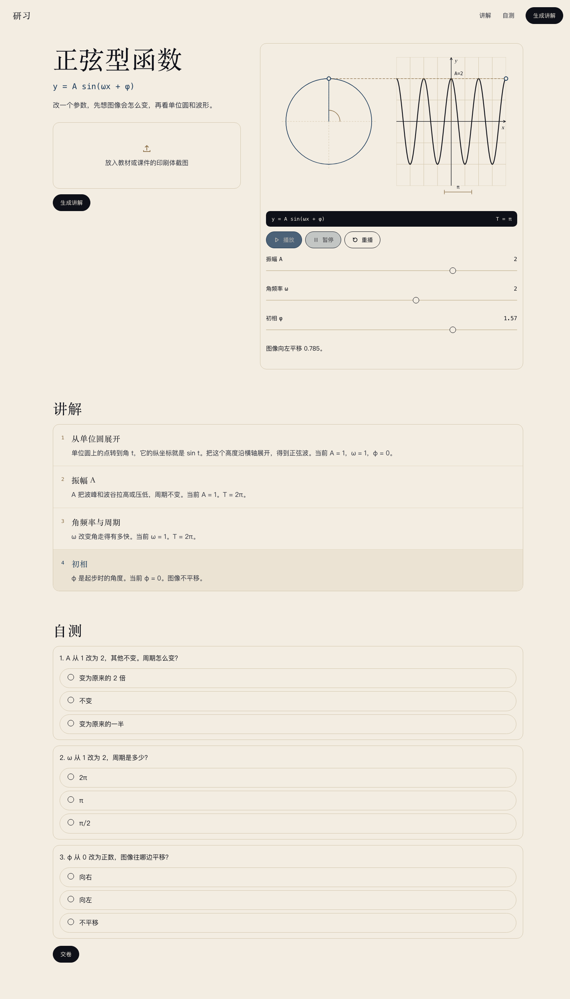
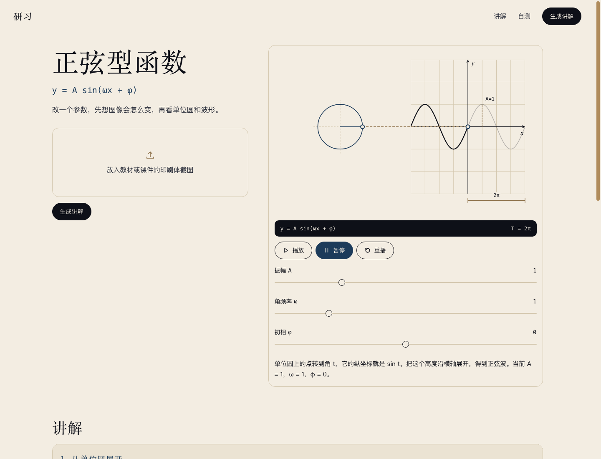

# 研习 · 正弦型函数 Lab 功能代码审计报告

| 项目 | 内容 |
| --- | --- |
| 审计对象 | studylab：server/、web/、设计开发方案.md |
| 审计日期 | 2026-11-08 |
| 代码基线 | Git 仓库尚无提交，全部文件为未跟踪工作树；按当前快照审计，无历史 diff 可对照 |
| 审计方式 | 静态代码审阅 + 后端测试 + 隔离实例 API 黑盒 + Chrome CDP 端到端 + 参数空间穷举 + 方案逐条对照 |
| 总体结论 | 功能主链路可运行，数学核心正确；存在 1 个高优先级一致性缺陷、4 个中优先级健壮性缺陷，以及若干低优先级问题。读图能力按方案仍为占位实现，不属于代码回归，但属于产品主路径缺口。 |

## 0. 结论摘要

默认样例、单位圆与正弦波同步动画、参数滑杆、三道自测、上传后的追问/确认/拒绝、服务离线降级，均已实际走通。后端 16 个测试全部通过；对滑杆可达的 343,434 组参数组合执行自检，0 失败；Python 与 JavaScript 的周期文本在 26 个 ω 取值上完全一致。

当前最需要先修的是：**拖动滑杆后，动画和读数更新了，但四步讲解正文仍写生成时的旧参数**。实测把 A、ω、φ 分别改为 2、2、1.57 后，页面同时显示 T = π 和讲解正文里的 T = 2π，且讲解仍写当前 A = 1、ω = 1、φ = 0。这直接违背“页面上的 T 用当前 ω 算出来”和“改参数后能预测图像怎么变”的验收口径。

其次是：**自检的周期校验用子串匹配，无法识别错误周期文本**。把讲解里的 T = 2π 改成 T = 2π/3 或 T = π 改成 T = π/2，自检仍返回通过。它守住了方向词，却没有守住方案要求的周期数值。

第三组是上传与资源边界：只按扩展名或 Content-Type 判断类型，零字节文件和伪造类型都能通过；8MB 限制在读完整个上传后才生效；内存中的 LESSONS 没有上限。当前服务是本机 127.0.0.1 使用，风险被部署方式压低，但代码层仍应补强。

读图适配器 [server/vision.py](server/vision.py#L9-L12) 永远返回 unknown，因此“上传印刷体图片、读出 A/ω/φ、一键生成”在产品层面尚未闭环。方案第 6 节已明确声明这一点，本次审计按“已知限制”处理，不计为回归；如果验收目标是真正读图，则这是最大的未完成项。

## 1. 审计范围与方法

### 1.1 范围

- [server/app.py](server/app.py)：路由、上传校验、课程暂存、静态页挂载。
- [server/sinusoid.py](server/sinusoid.py)：周期、方向、夹取、讲解模板、检查题、课程 JSON、自检。
- [server/skill.py](server/skill.py)：四步管线与两次自检失败处理。
- [server/vision.py](server/vision.py)：读图适配器占位。
- [server/test_sinusoid.py](server/test_sinusoid.py)：16 个后端测试。
- [web/app.js](web/app.js)、[web/sinusoid.js](web/sinusoid.js)、[web/index.html](web/index.html)、[web/styles.css](web/styles.css)：页面、交互、Canvas 动画、视觉。
- [设计开发方案.md](设计开发方案.md)：审计对照基线。

### 1.2 方法

1. 逐条阅读方案第 1–15 节，提取可验收条款。
2. 静态审阅全部业务代码，定位契约、数学、边界与安全问题。
3. 运行后端测试：16 passed。
4. 在隔离实例 127.0.0.1:8788 上跑 API 黑盒；8787 上已有实例也做了同样的健康检查与样例核对。
5. 用 Chrome 156 + CDP 在 1440px 与 390px 视口做真实页面交互：播放、暂停、重播、拖三个滑杆、提交三道题、上传、确认、拒绝、断服务降级。
6. 对 A/ω/φ 的所有滑杆步进组合穷举自检；对 26 个 ω 取值比对 Python/JS 周期文本。
7. 对关键缺陷做最小复现，保存截图与命令输出。

### 1.3 限制与未覆盖项

- 仓库没有提交历史，无法做 diff 审计，也无法判断问题是新引入还是既有。
- 读图适配器是占位实现，无法验证真实图片识别质量；本报告只验证其接口形状与调用分支。
- 浏览器验证只覆盖 Chrome；未覆盖 Safari、Firefox、移动端真机与屏幕阅读器。
- 未做压力测试、长时间运行测试、依赖漏洞扫描与渗透测试；相关问题按代码路径定性。
- 8787 上已有服务在运行；为避免干扰，API 复现主要使用 8788 隔离实例。

## 2. 方案逐条对照

| 方案条款 | 实现与验证 | 结论 |
| --- | --- | --- |
| §1 主路径：拍照/截图 → 生成讲解动画 | 上传分支存在，但 [server/vision.py](server/vision.py#L9-L12) 永远返回 unknown，只出追问，不读参数 | 部分符合；读图为方案已声明的已知限制 |
| §1 三条过关标准：数学正确、不看旁白能讲因果、改参数能预测 | 数学核心、因果模板、滑杆联动画都已实现；但滑杆改参后讲解正文仍是旧值（F-01） | 部分符合 |
| §3 做/不做：只做高一正弦型函数；不做多学科、手写、多题、账号等 | 代码只实现 sinusoid；无登录、支付、OCR、数据库；多图只判一次 | 符合 |
| §4 默认样例：无图打开即播放 A=1、ω=1、φ=0 | /api/sample 返回 sinusoid-sample；页面自动播放；9 秒后停在完整曲线并高亮 b4 | 符合 |
| §4 上传后先追问，不直接生成 | 上传任意合法图片走 vision.unknown，返回 asked 文案与两个选项 | 符合 |
| §4 选“是”生成，并说明当前读不出参数 | confirm=sinusoid 返回带 parameterNote 的完整课程 | 符合（但未要求图片，见 F-07） |
| §4 选“不是”只停说明 | confirm=reject 返回 declined，不生成 animation | 符合 |
| §4 多题不猜、不循环生成 | 服务端只做一次判定，不遍历图片内容 | 符合 |
| §5 周期 T = 2π/abs(ω)，abs(ω) 变大变密 | 后端 format_period/period_value 与前端 formatPeriod 一致；26/26 比对通过 | 符合 |
| §5 φ>0 向左、φ<0 向右、φ=0 不平移 | 后端 shift_direction、b4 文案、检查题 c3 一致；相位翻转突变可被自检拒绝 | 符合 |
| §5 A 变化不改周期 | 周期函数不接收 A；检查题 c1 恒为“不变”；测试覆盖 | 符合 |
| §5 参数范围、夹取、原值/采用值说明 | resolve_params 夹取 A/ω/φ；测试 A=9→2.5；ω=0→0.5；φ=9→3.14 | 符合 |
| §5 检查题按读到的参数重算 | build_checks 用当前 A/ω/φ 生成题面、选项、答案；自检比对重算结果 | 符合 |
| §6 四步管线：读图、列讲解、生成、自检 | skill.py 按步骤拆分；模型只留在 step1 的接口形状里 | 符合 |
| §6 读图现状：不把图判成正弦型函数 | vision.recognize 固定 unknown；有图只返回追问 | 符合方案声明 |
| §6 自检：参数范围、ω≠0、A>0、周期、方向、检查题唯一答案、beats 四步 | 参数、方向、检查题、beats 都检查；周期检查存在 F-02 的绕过 | 部分符合 |
| §6 自检两次失败返回 422，不返回未检查课程 | assemble_checked_lesson 重试一次后抛 LessonCheckError；测试覆盖 | 符合 |
| §7 /api/health、/api/sample | 200；sample 字段完整 | 符合 |
| §7 /api/lessons 四路径 | 无图、有图追问、confirm=sinusoid、confirm=reject 均已实测 | 符合 |
| §7 /api/lessons/check 按服务端课程判分 | 用 LESSONS 中的 checks 判分；3/3 与 0/3 均实测 | 符合 |
| §7 错误码与文案 | 400 文件错误、400 未答完、404 课程缺失、422 自检失败均有测试或实测 | 符合 |
| §8 视觉：纸色、字色、衬线标题、胶囊按钮、16px 卡片、1240px | styles.css 的 token 与方案表一致；截图核对 | 符合 |
| §8 布局与状态：两列、上传卡、追问区、生成中、结果 | 默认/拖入/生成中/追问/失败/未答完/结果均有对应 UI | 符合 |
| §8 窄屏：880 以下收起文字链，390 仍可操作 | CDP 390px：innerWidth=390、scrollWidth=390，无横向溢出 | 符合 |
| §9 设备像素比、单位圆+波形、播放/暂停/重播 | Canvas 按 dpr 缩放；三类控制可用；9 秒后 settled | 符合 |
| §9 已走过波形与未走过波形 | 有深/浅两段，但 t=0 时左侧负半轴已画成深色（F-06） | 部分符合 |
| §9 滑杆暂停、重画、图下写因果 | 暂停与重画正确；A/ω/φ 的 caption 正确；四步正文不跟随（F-01） | 部分符合 |
| §9 键盘：滑杆左右键、动画区空格播放 | 滑杆用原生 range；空格只在 #anim 内响应 | 符合（未做自动化键盘测试） |
| §10 代码结构 | 文件与方案第 10 节逐一对应 | 符合 |
| §11 测试：7 个指定场景 | 16 个测试覆盖全部指定场景 | 符合；覆盖范围仍有缺口（F-15） |
| §12 验收 7 条 | 6 条通过；“ω 拖到 2 文案说变密”中 caption 通过但讲解正文仍写 T=2π（F-01） | 部分符合 |
| §13 运行方式 | venv、pytest、uvicorn 命令均可用 | 符合 |
| §15 风险 | 相位方向被自检与测试锁住；读图断点已显式化；模型写旁白时只收字段 | 符合 |
| §14 下一版 | 未实现真实视觉接口、手写体、第二概念族 | 不适用（方案明确延后） |

## 3. 问题清单

| ID | 严重度 | 问题 | 主要位置 | 状态 |
| --- | --- | --- | --- | --- |
| F-01 | 高 | 滑杆改参后四步讲解正文不更新，与读数和 caption 矛盾 | server/sinusoid.py:206-241；web/app.js:284-289；web/sinusoid.js:512-530 | 已复现 |
| F-02 | 中 | 自检的周期校验是子串匹配，错误周期文本可通过 | server/sinusoid.py:349-358 | 已复现 |
| F-03 | 中 | 图片类型/空文件校验只看声明，不验证字节内容 | server/app.py:28-43、114-127 | 已复现 |
| F-04 | 中 | 8MB 限制在整体读入后才生效，超大上传先占磁盘/内存 | server/app.py:114-127 | 代码路径确认 |
| F-05 | 中 | LESSONS 无上限、无过期，长期运行内存持续增长 | server/app.py:25、57-59、129-138 | 代码路径确认 |
| F-06 | 低 | t=0 时波形左半段已显示为“已走过” | web/sinusoid.js:82、242、279-283 | 已复现 |
| F-07 | 低 | confirm=sinusoid 不要求图片、不要求先追问 | server/app.py:129-132 | 已复现 |
| F-08 | 低 | 越界答案返回 200 并判错；total 硬编码 3 | server/app.py:84-90、158-163 | 已复现 |
| F-09 | 低 | 前端把 404/422 等服务端错误显示成“服务没连上” | web/app.js:318-335、427-455 | 代码路径确认 |
| F-10 | 低 | 顶栏“生成讲解”无文件时只滚动，不生成 | web/app.js:496-499 | 代码路径确认 |
| F-11 | 低 | 初始 sample 请求与生成请求无竞态保护 | web/app.js:535、318-335、355-359 | 代码路径确认 |
| F-12 | 低 | 读图适配器未来返回非数字/部分参数时可能 500 或无提示 | server/sinusoid.py:129、skill.py:88-94 | 代码路径确认，当前不可达 |
| F-13 | 低 | 可访问性与减少动效缺口 | web/index.html:30、88；web/app.js:435-449 | 代码审阅 |
| F-14 | 低 | 默认课程重复、周期格式化双实现、死代码、重复自检 | web/app.js:48-81；sinusoid.py / sinusoid.js | 代码审阅 + 对比 |
| F-15 | 低 | 前端与边界场景测试缺口 | server/test_sinusoid.py 及仓库 | 审计结论 |

### F-01（高）滑杆改参后讲解正文不跟随，页面同时给出矛盾结论

**位置**

- 讲解正文在生成时就把 A、ω、φ、T 写死：[server/sinusoid.py](server/sinusoid.py#L206-L241) 的 _beat_narration。
- 滑杆 input 只更新显示值和动画：[web/app.js](web/app.js#L284-L289)；setParams 只重画并发出 caption：[web/sinusoid.js](web/sinusoid.js#L512-L530)。没有任何代码改写四步讲解的 DOM 文本（渲染在 [web/app.js](web/app.js#L196-L216)）。

**复现（Chrome CDP，1440px，2026-11-08）**

操作：依次把 A 设为 2、ω 设为 2、φ 设为 1.57。

    readout-period : T = π
    caption        : 图像向左平移 0.785。
    b1             : 当前 A = 1，ω = 1，φ = 0。
    b2             : 当前 A = 1。T = 2π。
    b3             : 当前 ω = 1。T = 2π。
    b4             : 当前 φ = 0。图像不平移。
    自测第 2 题     : ω 从 1 改为 2，周期是多少？

同一时刻，波形已经按 A=2、ω=2、φ=1.57 重画，读数 T=π，caption 说向左平移 0.785；但高亮的第 4 步仍写“当前 φ = 0。图像不平移”。学生看到的是两套互相矛盾的事实。

**规格对照**

- §5：“周期是 T=2π/|ω|，页面上的 T 用当前 ω 算出来。”
- §9：“拖动滑杆时暂停播放，立刻用新参数重画整条曲线，并在图下写当前焦点的那句因果。”
- §12：“将 ω 从 1 拖到 2，图上周期从 2π 变为 π，文案说图像变密。”

caption 和读数满足，四步讲解正文不满足；因此 §12 这条验收只能算部分通过。

**影响**

- 高。它是核心学习页，讲解正文直接写“当前”参数，改参后变成错误陈述；学生会把 T=2π 与图上的 π 同时记住。
- 三道检查仍按生成时的参数出题；滑杆改到 ω=2 后，第 2 题还问“ω 从 1 改为 2”，与当前画面也不一致。
- 这不是视觉瑕疵，而是数学一致性缺陷，优先级应高于样式与文案润色。

**建议**

1. 明确一个单一事实源：课程基准参数和当前交互参数必须区分。若讲解要写“当前”，就在 setParams 时用同一套模板重写 b1–b4，并同步更新 caption、读数和检查题。
2. 若产品希望检查题保持稳定，则把四步正文改成不写具体数值的因果句，把当前 A/ω/φ/T 只放在读数与 caption；同时在页面上标明“本课基准参数”，避免“当前”二字。
3. 无论选哪种，加一条前端一致性测试：对每个滑杆值，页面上所有 T 文本必须相等，所有 A/ω/φ 文本必须等于滑杆值。
4. 若滑杆改参后要重新出题，应生成新的 lesson id，服务端按新课程判分，避免旧 checks 与新参数混用。

### F-02（中）自检的周期校验可被字符串包含绕过

**位置**

[server/sinusoid.py](server/sinusoid.py#L349-L358)。自检先用 format_period(omega) 生成 period_text，再用 parse_period_text(period_text) 反解，然后用 f"T = {period_text}" 做子串包含判断。

问题有三层：

1. parse_period_text 解析的是 format_period 的输出，不是讲解正文；它验证的是格式化函数自洽，不是课文内容。
2. 子串判断没有词边界：“T = 2π” 是 “T = 2π/3” 的前缀，“T = π” 是 “T = π/2” 的前缀，所以错误文本也能通过。
3. 自检重算 checks 用的是同一个 build_checks；如果 build_checks 本身有数学错误，自检发现不了。该问题由测试补足，但自检本身不独立。

**复现（脚本，2026-11-08）**

把有效课程 b2、b3 的 T 文本替换成错误值，再调用 inspect_lesson：

    omega=1: 替换 'T = 2π'  -> 'T = 2π/3'   => inspect=True
    omega=2: 替换 'T = π'   -> 'T = π/2'    => inspect=True
    omega=3: 替换 'T = 2π/3'-> 'T = 2π/3/7' => inspect=True
    phase  : 替换 '向左'    -> '向右'       => (False, 'φ>0 时应向左平移')

方向校验有效，周期校验无效。

**规格对照**

§6 自检条目明确要求“讲解文本里的周期与 2π/|ω| 一致，容差 10^-6”。当前实现没有真正读取讲解里的周期数值，因此没有履行这条承诺。

**影响**

- 中。当前模板生成的文本是正确的，所以默认样例不会立刻出现错误；但自检是返回前端前的最后一道数学门禁，门禁对最核心的数值失效。
- 未来若换读图适配器、换讲解模板、或允许模型参与正文，错误周期可能直接上线。
- 对“数学正确”这条产品验收标准，这是防御性缺陷。

**建议**

1. 用正则从讲解正文提取所有周期表达式，例如匹配“T = 数字/π 组合”，逐个 parse 后与 period_value(omega) 比较，容差 1e-6；不要只比对格式化结果。
2. 或让讲解由结构化 token 生成，自检直接比对 token，而不是自由文本。
3. 增加回归测试：分别把 b2/b3 的周期改成前缀相同但数值错误的文本，要求 inspect_lesson 返回 False。
4. 对检查题增加独立数学断言：不只比较 build_checks 的输出，还要验算“正确答案的文本确实等于期望值”。

### F-03（中）图片类型与空文件校验只看声明，不看内容

**位置**

[server/app.py](server/app.py#L28-L43) 的 _image_type_ok：Content-Type 命中白名单就返回 True，否则看扩展名；两者是 OR 关系。validate_image_upload 只检查 size > 8MB 与类型，不检查 size > 0，也不检查 magic bytes。[server/app.py](server/app.py#L114-L127) 在读完上传后调用它。

**复现（隔离实例 8788，curl）**

| 请求 | 状态 | 结果 |
| --- | --- | --- |
| notes.txt + text/plain | 400 | 正确拒绝 |
| page.png + text/plain（扩展名伪造） | 200 | 返回追问，未拒绝 |
| notes.txt + image/png（Content-Type 伪造） | 200 | 返回追问，未拒绝 |
| 0 字节 page.png + image/png | 200 | 返回追问，未拒绝 |
| 9MB page.png + image/png | 400 | 最终拒绝，但已在读完整个上传之后 |

客户端的 [web/app.js](web/app.js#L130-L136) 更严格一些：text/plain + .png 会被前端拒绝；但伪造 Content-Type 为 image/png 仍能通过。服务端才是权威边界，当前边界没有验证真实图片。

**影响**

- 中（契约）。错误文案承诺只收 png、jpeg、webp，但服务端实际接受任意扩展名/类型的组合。
- 当前不会导致崩溃，因为 vision.recognize 只检查 bytes 类型，不解码图片。
- 一旦接入真正的视觉模型或 Pillow 解码，垃圾字节会进入下游，可能得到低质量识别或异常。

**建议**

1. 读取前检查 upload.size > 0，拒绝空文件。
2. 读取后检查 magic bytes：PNG 的 89 50 4E 47 0D 0A 1A 0A；JPEG 的 FF D8 FF；WebP 的 RIFF....WEBP。
3. 可选地用 Pillow 做 Image.open(...).verify()，同时限制像素尺寸，防止解压炸弹；Pillow 已在依赖里。
4. 客户端与服务端使用同一套规则，错误文案保持一致。

### F-04（中）8MB 限制在整体读入后才生效

**位置与事实**

[server/app.py](server/app.py#L114-L121)：先 await request.form()，再 await upload.read()，然后才在 124–127 行用 len(image_bytes) 判断 8MB。

本机 Starlette 1.10.0 的实际行为：

- Request.form(max_part_size=1MB) 的 max_part_size 只作用于非文件字段；文件字段走 SpooledTemporaryFile，超过 1MB 落到临时磁盘，但没有总量上限。
- upload.read() 会把整个文件读进内存；8MB 判断发生在读完之后。

因此 8MB 是“事后判定”，不是“读取上限”。9MB 请求能返回 400，只证明结果，不证明读取被限制。

**影响**

- 中（资源耗尽）。超大 multipart 上传会先写临时磁盘、再占内存；本机部署风险较低，但任何能访问端口的页面都可以触发。
- 若按 §13 的命令只监听 127.0.0.1，风险主要是本机误操作与本地恶意页面；若改成 0.0.0.0，则变成真实的 DoS 面。

**建议**

1. 在解析表单前检查 Content-Length；chunked 请求则加 ASGI 层的累计字节上限。
2. 解析后先看 upload.size（Starlette 的 UploadFile 已记录 size），超过 8MB 立即拒绝，不调用 read。
3. 分块读取，最多读 MAX+1 字节，边读边判；或使用临时文件 + 文件大小检查。
4. 增加 HTTP 层测试：9MB、100MB、chunked 上传都应在内存受控的前提下返回 400。

### F-05（中）LESSONS 无上限增长

**位置**

[server/app.py](server/app.py#L25) 的全局 dict；[server/app.py](server/app.py#L57-L59) 的 _remember；每次 confirm=sinusoid 或 lesson_from_recognition 都用 new_lesson_id 生成新 key 并永久保存（129–138 行）。/api/sample 用固定 key，不增长；生成的课不删除。

**影响**

- 中（本地部署下风险偏低）。设计明确说“课程存在内存即可，进程重启后失效”，但没有说可以无限增长。
- 每次生成约几 KB；长时间运行或脚本循环调用会线性增长，最终 OOM。
- F-07 让 confirm=sinusoid 可以在没有图片、没有追问的情况下反复调用，进一步放大。

**建议**

1. 使用简单的 LRU 或 TTL，例如最多保留 256 节，或 30 分钟过期。
2. 或按会话/浏览器保存最近一节；单用户学习工具不需要永久保存所有生成结果。
3. 增加测试：连续生成 N 节后，LESSONS 长度不超过上限。

### F-06（低）t=0 时波形左半段已显示为“已走过”

**位置**

[web/sinusoid.js](web/sinusoid.js#L82) 默认 domain 为 [-2π, 2π]；[web/sinusoid.js](web/sinusoid.js#L242) 的 head = min(max(t, domain[0]), domain[1])；279–283 行把 domain[0] 到 head 画成深色。t 从 0 开始时，深色范围是 [-2π, 0]。

**复现**

点击“重播”后立刻“暂停”，截图为 t=0：波形负半轴已经是深色，正半轴是浅色，当前点在 x=0。

**规格对照**

§9 明确写“同一个参数 t 从 0 走到 2π”“已走过的波形留下，未走过的用更浅的线”。t=0 时不该有左侧半段的历史。

**影响**

- 低，但它是核心动画的起始状态；学生会误以为动画从 -2π 开始，或以为左侧是上一轮留下的。
- 也会让“当前点 x=0”与“深色区域到 x=0”在视觉上自相矛盾。

**建议**

- 方案 A：domain 改为 [0, 2π]，与 t 的范围一致。
- 方案 B：保留 [-2π, 2π] 作为坐标范围，但深色只从 max(0, domain[0]) 画到 head；负半轴始终浅色。
- 方案 C：让 t 从 domain[0] 走到 domain[1]，圆上的相位同步改；这样“从左往右扫过”与圆参数一致，但要同步调整 focus 时间轴。

### F-07（低）confirm=sinusoid 不要求图片或先追问

**复现（curl）**

    curl -s -X POST http://127.0.0.1:8788/api/lessons -F 'confirm=sinusoid'
    => 200，返回 id=sinusoid-xxxxxxxx，parameterNote="这版还不能从图片读出参数。图上未标出参数，先按 A=1，ω=1，φ=0 讲这个知识点。"

无图片也生成了一节完整课程，并写入 LESSONS；文案还声称“不能从图片读出参数”，但实际上没有图片。

另外，正常 confirm=sinusoid 路径的 CONFIRMED_NOTE（[server/skill.py](server/skill.py#L13-L15)）同时写“这版还不能从图片读出参数”和“图上未标出参数”。后者在未读图时无法成立：我们不知道图上有没有标；建议只保留前者，或在真正的读图适配器接入后再写“未标出”。

**规格对照**

§7 明确“confirm 只有上一次返回了追问之后，前端才带这个字段”。这是前端行为约定；服务端目前无条件接受。前端确实只在 confirmYes 时发，但 API 本身没有约束。

**影响**

- 低：前端正常路径不会触发；直接调 API 会得到语义不通的课程，并可被用来放大 F-05 的内存增长。

**建议**

- 至少要求同时带 image；没有 image 时返回 400 或按默认样例处理但不要写“读不出图片参数”。
- 更严谨的做法是在追问响应里发一个一次性 token，confirm 时校验 token 与图片摘要；第一版本地工具可先用“必须有 image”这个低成本约束。

### F-08（低）越界答案返回 200；total 硬编码

**复现**

    answers=[9,9,9]   => 200，correct=0，total=3，items 都 ok=false
    answers=[true,true,true] => 400（bool 被显式拒绝）
    answers=[1.0,1,1] => 400（非 int）

[server/app.py](server/app.py#L84-L90) 只校验长度与 int，不校验下标范围；158–163 行直接用 given == answer 判分。total 直接写 3，而不是 len(lesson["checks"])。

**影响**

- 低。前端永远发 0/1/2；越界输入判错也说得通。
- 但“答案下标越界”和“答错”是不同语义；total 硬编码会在将来题目数量变化时静默错报。

**建议**

1. 校验每个 answer 是 int 且 0 <= answer < len(check["choices"])；不合法返回 400。
2. total 改为 len(lesson["checks"])。

### F-09（低）前端把 404/422 等服务端错误显示成“服务没连上”

**位置**

- [web/app.js](web/app.js#L318-L335) 的 loadSample：只要 res.ok 为 false 就抛错，catch 统一显示 OFFLINE，并 applyLesson(builtinLesson())。
- [web/app.js](web/app.js#L427-L455) 的 check 提交：if (!res.ok) throw new Error("status")，catch 统一显示 OFFLINE。

服务端在课程缺失时返回 404（[server/app.py](server/app.py#L151-L154)），自检失败时返回 422（[server/app.py](server/app.py#L139-L140)），前端都没有解析这些 JSON。

**影响**

- 低但会误导。服务重启后，学生留在页面提交自测，会看到“讲解服务没连上”，而不是“这节课已经不在了，请重新打开页面”。
- 自检失败被显示成离线，也会掩盖真正原因。
- 前端还会把 state.serviceUp 置 false，后续操作继续走离线提示。

**建议**

- 区分 fetch 抛出的网络错误（TypeError）与 HTTP 非 2xx；对后者解析 body.error，按 400/404/422 显示服务端文案。
- 只有网络错误才显示 OFFLINE 并把 serviceUp 置 false。

### F-10（低）顶栏“生成讲解”无文件时只滚动，不生成

**位置**

[web/app.js](web/app.js#L496-L499)：点击 navGenerate 先 scrollIntoView；只有 state.file 存在时才调用 generate()。无文件时主按钮不触发默认样例加载，而正文的“生成讲解”按钮会调用 loadSample。

**规格对照**

§8 说顶栏主按钮是“生成讲解”。两个同名按钮在无文件时行为不同，用户容易以为按钮坏了。

**影响**

- 低；不影响核心链路，但违反主按钮的一致预期。

**建议**

- 无文件时也调用 generate()（即 loadSample(true)），与正文按钮一致；或把顶栏按钮改成“上传并生成”，明确它的职责。

### F-11（低）初始 sample 与生成请求无竞态保护

**位置**

页面加载即调用 loadSample(false)（[web/app.js](web/app.js#L535)）；它没有请求序号或 AbortController。若用户在初始请求返回前上传并生成，postLesson 可能先 applyLesson，随后旧 sample 响应到达并 applyLesson 默认课程（[web/app.js](web/app.js#L355-L359)），覆盖刚生成的内容。

**影响**

- 低；本机响应很快，窗口很小，但属于真实的异步竞态。
- 同类问题也存在于连续点击生成（虽然按钮 disabled 降低了概率）。

**建议**

- 给每次请求分配递增 id，回调时只接受最新 id；或用 AbortController 取消旧请求。
- 初始加载完成前禁用生成按钮，或至少不要用旧响应覆盖新课程。

### F-12（低）读图适配器返回非数字/部分参数时的边界

**位置**

[server/sinusoid.py](server/sinusoid.py#L129) 直接 float(raw)；[server/skill.py](server/skill.py#L88-L94) 把 recognition 的 A/omega/phi 传入 step2_plan；[server/app.py](server/app.py#L139-L140) 只捕获 skill.LessonCheckError。若未来适配器返回 "2π/3"、"abc"、NaN 等，float 会抛 ValueError/TypeError，接口变成 500。

另外，[server/sinusoid.py](server/sinusoid.py#L123-L141) 的 any_given 只要有一个参数给出，就不会补“图上未标出参数”的说明；A=2、ω 缺失时，note 为 None，但实际用了默认 ω=1。未来接入真实读图后，这会让学生以为三个参数都是从图上读出来的。

**影响**

- 低，当前 vision 永远返回 unknown，这条路径不可达。
- 一旦换适配器，这是最先暴露的兼容性问题。

**建议**

- 对 recognition 字段做显式解析与范围校验，解析失败走追问或 422，不抛 500。
- 记录每个参数是否缺失，在 parameterNote 里分别说明。
- 用 fake adapter 写契约测试，覆盖字符串、NaN、部分缺失、超范围。

### F-13（低）可访问性与减少动效缺口

**位置与问题**

- [web/index.html](web/index.html#L30) 的 file input 是 1px 隐藏输入，没有 label 或 aria-label；辅助技术可能读到一个无名称的文件输入。
- [web/index.html](web/index.html#L88) 的 check-banner 与 [web/app.js](web/app.js#L439-L449) 的 verdict/explain 没有 aria-live；提交后的对错结果不会被屏幕阅读器主动播报。
- 页面加载即自动播放 8 秒动画（[web/sinusoid.js](web/sinusoid.js#L543)），没有 prefers-reduced-motion 分支。

**影响**

- 低（无障碍）。不影响普通用户，但对键盘/读屏/晕动敏感用户不友好。

**建议**

- 给隐藏 input 加 aria-label="选择教材或课件图片"，或把它与按钮关联。
- 给 check-banner、verdict 加 role=status/aria-live=polite。
- 在 prefers-reduced-motion: reduce 时默认暂停，或把动画时长降为 0 只显示完整曲线。

### F-14（低）重复实现、死代码与重复自检

- [web/app.js](web/app.js#L48-L81) 的 builtinLesson 复制了一份默认课程，但 beats 文本、checks（缺 answer/explain）、参数说明与服务端不一致。离线只用于展示，但长期会漂移。
- 周期文本在 Python（[server/sinusoid.py](server/sinusoid.py#L53-L70)）与 JS（[web/sinusoid.js](web/sinusoid.js#L24-L34)）各实现一次。本次 26 个 ω 取值比对全部一致，但仍是双份维护。
- shift_amount（[server/sinusoid.py](server/sinusoid.py#L99-L100)）未被使用；lesson_for_reading（[server/sinusoid.py](server/sinusoid.py#L298-L300)）只被测试使用；_checked（[server/app.py](server/app.py#L62-L63)）只是 _remember 的别名。
- assemble_checked_lesson（[server/skill.py](server/skill.py#L56-L65)）先 inspect_lesson，再 step4_self_check，而 step4_self_check 又是 inspect_lesson；同一课程被检查两次。
- 测试 test_amplitude_does_not_change_period（[server/test_sinusoid.py](server/test_sinusoid.py#L85-L96)）用 co_varnames 断言函数没有 amplitude 参数，属于实现细节断言，重构时容易误报。

**影响**：低，主要是维护成本与漂移风险。

**建议**：把默认课程抽成共享 JSON 或由后端提供 builtin 数据；至少加一条前后端默认文案对比测试。周期格式化保留双实现时，加跨语言对拍测试。清理死代码，合并重复自检。

### F-15（低）测试与工程化缺口

**已有**：16 个后端测试覆盖方案 §11 指定的全部场景，且本次额外跑了 343,434 组参数与 26 组跨语言周期比对。

**缺口**：

- 没有前端单测或 E2E 测试；本次用 CDP 手工验证，但没有可重复执行的仓库内脚本。
- 没有测试自检对讲解文本的篡改（F-02 就是这样漏掉的）。
- 没有测试伪造扩展名/Content-Type、零字节、超大 body、chunked 上传。
- 没有测试 LESSONS 上限、confirm 无图、total 与题数一致性。
- 没有 CI、lint、类型检查；依赖版本用 >= 范围，不可复现。

**建议**：把本次的 343k 穷举、跨语言周期对拍、CDP 上传/滑杆/判分流程固化为脚本；至少加自检篡改测试与上传边界测试。

## 4. 安全专项

| 项目 | 结论 | 依据 |
| --- | --- | --- |
| 密钥与网络 | 正面 | server/ 与 web/ 业务代码 grep 未发现 os.environ、httpx 调用、API_KEY 或 MINIMAX 引用；方案文档提到过 MINIMAX 环境变量，但代码不读取。requirements 中的 httpx 只用于测试。 |
| 日志泄露 | 正面 | 代码不打印图片字节、密钥或用户输入。 |
| XSS | 正面 | 前端动态内容全部走 textContent；未发现 innerHTML、eval、document.write；CSS.escape 用于 id 选择器。 |
| 路径遍历 | 正面 | 静态文件只挂载 [web](web) 目录，使用 Starlette StaticFiles。 |
| 上传内容 | 负面 | F-03：类型/空文件不验证真实内容。 |
| 上传体积 | 负面 | F-04：8MB 在整体读入后才判。 |
| 内存边界 | 负面 | F-05：LESSONS 无上限。 |
| CSRF | 需注意 | 无 CSRF token；跨站表单可以对本机 8787 发简单 POST。响应受同源策略保护，但请求会产生课程与内存写入。本地工具可接受，但不要把端口暴露到公网。 |
| 认证/限流 | 不适用/需注意 | 方案明确不做账号；本地单用户。若监听 0.0.0.0，任何人都能调用生成与判分接口。 |
| 图片解码 | 当前安全 | 当前不解码图片；未来加 Pillow 解码时要防解压炸弹与恶意图片解析漏洞。 |
| 依赖 | 需注意 | requirements.txt 使用 >= 范围，未锁定版本；建议生成 lock 或固定版本，至少在 CI 中固定。 |

## 5. 测试与运行证据

### 5.1 后端测试

    $ server/.venv/bin/pytest server/test_sinusoid.py -q
    16 passed, 1 warning in 0.13s

测试覆盖：默认 2π、ω=2 时 π、φ>0 向左、φ<0 向右、A 不改周期、错答判错、全对 3/3、自检失败 422、无图默认、有图追问、确认生成、拒绝、类型/大小、夹取、健康检查、缺失课程/未答完。

### 5.2 参数空间穷举

对 A 的 21 个步进、ω 的 26 个步进、φ 的 629 个步进做笛卡尔积，逐节调用 inspect_lesson：

    combos checked: 343434
    self-check failures: 0

这说明在滑杆可达范围内，参数、方向、检查题、beats 与 T 文本的自洽性没有发现反例。注意：这不能替代 F-02 的篡改测试，因为穷举用的是同一个生成器。

### 5.3 跨语言周期一致性

对 ω = 0.5 到 3.0 的 26 个滑杆取值，比对 Python format_period 与 JS SinusoidStage.formatPeriod：

    compared: 26, mismatches: []

示例：0.5→4π、0.7→20π/7、1.1→20π/11、1.3→20π/13、2.0→π、2.5→4π/5、3.0→2π/3。

### 5.4 API 黑盒

| 场景 | 结果 |
| --- | --- |
| GET /api/health | 200 {"ok": true} |
| GET /api/sample | 200；id=sinusoid-sample；params [1,1,0]；answers [1,1,1]；beats 4；checks 3 |
| POST /api/lessons 无图 | 200；默认课程；写入 LESSONS |
| POST /api/lessons 有图 | 200；id=null；asked 正确；无 animation |
| POST /api/lessons confirm=sinusoid + 图 | 200；完整课程；parameterNote 含“这版还不能从图片读出参数” |
| POST /api/lessons confirm=reject | 200；declined 正确；无 animation |
| POST /api/lessons/check [1,1,1] | 200；correct=3；total=3；items 3 条 |
| POST /api/lessons/check [0,0,0] | 200；correct=0；每个 item 都有 explain |
| POST /api/lessons/check 缺题 | 400；请答完三道题再提交。 |
| POST /api/lessons/check 未知 id | 404；这节课已经不在了，请重新打开页面。 |
| 9MB 上传 | 400；请上传 8MB 以内的 png、jpeg 或 webp。 |
| 自检失败（monkeypatch） | 422；这节课没有通过数学自检，没有生成。 |

### 5.5 浏览器端到端（Chrome 156，CDP）

| 场景 | 结果 |
| --- | --- |
| 1440px 默认加载 | 无横向溢出；T=2π；自动播放；9 秒后 settled，高亮 b4 |
| 390px 视口 | innerWidth=390；scrollWidth=390；卡片单列；上传/播放可用 |
| 滑杆 A=2 | caption“波峰变为当前的 2，周期仍是 2π”；读数跟随 |
| 滑杆 ω=2 | 读数 T=π；caption“周期变为 π，图像变密。”；播放暂停 |
| 滑杆 φ=1.57（ω=2） | caption“图像向左平移 0.785。” |
| 三道题选 1/1/1 提交 | banner“对了 3 / 3”；三题均“对”；explain 与服务端一致 |
| 上传 png | 出现追问，不生成 animation |
| 确认“是” | 生成课程；显示 parameterNote；sliders=3；checks=3；beats=4 |
| 再次上传后选“不是” | 显示“第一版只生成正弦型函数…”，隐藏两个选项 |
| 断开 API（仅静态服务器） | 显示“讲解服务没连上”；仍渲染 4 段讲解、3 个滑杆、3 道题；提交显示离线提示；无 JS 异常 |

### 5.6 截图证据

- 默认桌面：[audit-evidence/desktop-default.png](audit-evidence/desktop-default.png)
- 390px 移动端：[audit-evidence/mobile-390.png](audit-evidence/mobile-390.png)
- 滑杆改参与讲解矛盾：[audit-evidence/sliders-vs-narration.png](audit-evidence/sliders-vs-narration.png)
- t=0 波形起点：[audit-evidence/wave-at-t0.png](audit-evidence/wave-at-t0.png)

## 6. 修复建议与优先级

### 发布前必须处理

1. **F-01**：统一“课程基准参数”与“当前交互参数”；让页面上所有 A/ω/φ/T 文本一致。验收：把 A/ω/φ 拖到任意值，页面所有 T 文本相同，所有参数文本等于滑杆值；检查题与当前参数的关系有明确说明。
2. **F-02**：自检真正解析讲解正文里的周期数值，并加篡改回归测试。验收：把 T=2π 改成 T=2π/3 时，assemble_checked_lesson 必须失败或重试后 422。
3. **F-03/F-04**：上传前检查 Content-Length/upload.size，读取有上限；校验 magic bytes 与空文件。验收：伪造扩展名、零字节、9MB、100MB 都返回 400，且不产生不受控的内存/磁盘占用。

### 建议同批处理

4. **F-05**：LESSONS 加上限/TTL。
5. **F-06**：修正 t=0 的“已走过”范围，或调整 domain。
6. **F-09**：前端区分网络错误与 HTTP 错误，显示服务端真实文案。

### 可排期处理

7. F-07、F-08、F-10、F-11、F-12、F-13、F-14、F-15。

### 产品决策项

- 滑杆改参后，三道检查题是否要同步重算？当前是“题面固定、画面可改”，容易让学生觉得题目与当前图无关。若要保持固定，建议在自测区标注“本题按本课初始参数 A=1、ω=1、φ=0 出题”。
- 读图适配器何时接入真实视觉模型？接入时必须复用同一套自检，并补 F-12 的契约测试。

## 7. 正面结论

- 分层清晰：[server/sinusoid.py](server/sinusoid.py) 是纯数学与模板，[server/skill.py](server/skill.py) 是管线，[server/app.py](server/app.py) 是薄路由；与方案 §10 完全对应。
- 数学核心正确：周期、方向、振幅、夹取、检查题重算都有测试与穷举支撑。
- 自检对方向词、检查题唯一答案、beats 完整性有效；方向翻转会被拒绝。
- API 字段、错误码、四条上传路径与判分路径均符合方案。
- 前端无 XSS 面、无密钥/网络/日志泄露；离线降级可用；1440 与 390 布局均无横向溢出。
- 视觉 token 与方案 §8 的纸色、字色、衬线、胶囊、16px 卡片、1240px 宽度一致。

## 8. 附录

### 8.1 环境

    macOS Darwin arm64
    Python 3.14.6
    FastAPI 0.162.2 / Starlette 1.10.0 / Uvicorn 0.54.0
    pytest 9.2.0 / Pillow 13.0.0 / httpx 0.28.1
    Node 24.19.0
    Google Chrome 156.0.8078.80

### 8.2 复现命令

    # 后端测试
    server/.venv/bin/pytest server/test_sinusoid.py -q

    # 启动隔离实例
    server/.venv/bin/uvicorn app:app --app-dir server --port 8788 --host 127.0.0.1

    # 样例
    curl -s http://127.0.0.1:8788/api/sample

    # 上传
    curl -s -X POST http://127.0.0.1:8788/api/lessons -F 'image=@/tmp/audit-page.png;type=image/png'

    # 确认/拒绝
    curl -s -X POST http://127.0.0.1:8788/api/lessons -F 'confirm=sinusoid' -F 'image=@/tmp/audit-page.png;type=image/png'
    curl -s -X POST http://127.0.0.1:8788/api/lessons -F 'confirm=reject'

    # 判分
    curl -s -X POST http://127.0.0.1:8788/api/lessons/check -H 'Content-Type: application/json' -d '{"lessonId":"sinusoid-sample","answers":[1,1,1]}'

    # 自检篡改复现（示例）
    server/.venv/bin/python - <<'PY'
    import sys; sys.path.insert(0, 'server')
    import sinusoid
    lesson = sinusoid.build_lesson(1, 1, 0, 'x', None)
    for beat in lesson['beats']:
        if beat['id'] in ('b2','b3'):
            beat['narration'] = beat['narration'].replace('T = 2π', 'T = 2π/3')
    print(sinusoid.inspect_lesson(lesson))  # 期望 (False, ...)，实际 (True, '')
    PY

### 8.3 检查脚本的说明

本次穷举与自检绕过脚本已固化在 [audit-evidence/verify_parameters.py](audit-evidence/verify_parameters.py) 与 [audit-evidence/verify_selfcheck_bypass.py](audit-evidence/verify_selfcheck_bypass.py)，在仓库根目录运行：

    server/.venv/bin/python audit-evidence/verify_parameters.py
    server/.venv/bin/python audit-evidence/verify_selfcheck_bypass.py

跨语言周期比对是现场 Node + Python 脚本（26 个 ω 取值，结果 26/26），未固化为仓库文件；如要进 CI，建议补一个 Node + pytest 对拍测试。

### 8.4 报告边界

本报告只对 2026-11-08 的当前工作树快照负责；仓库没有提交，后续改动无法用 diff 追溯。动态结论以 Chrome 156 与隔离实例 8788 为准；真实视觉识别质量未验证。
